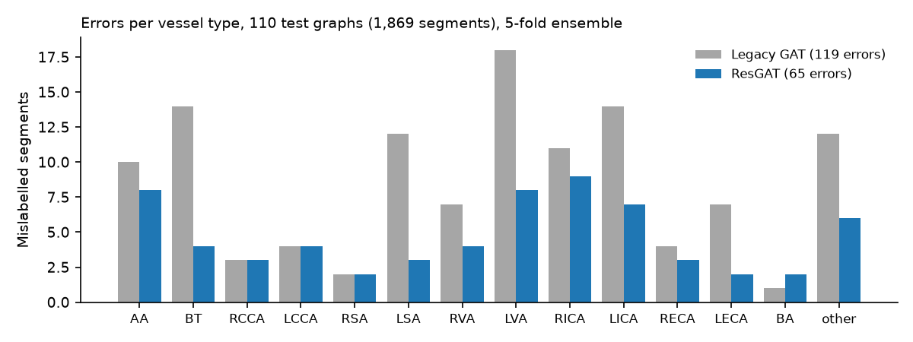
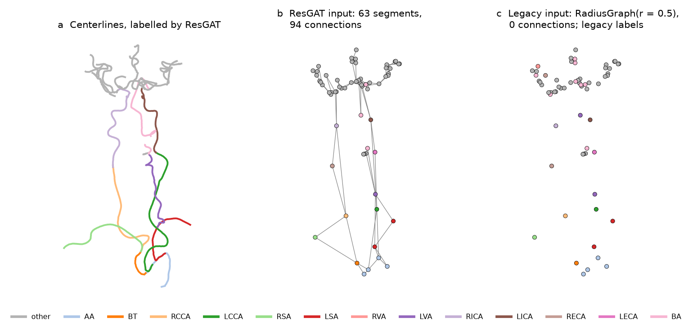

# Extracranial vessel labelling: ResGAT

**The new default labeller makes 45% fewer errors: 65 mislabelled segments instead of 119 on 110 held-out test graphs.**
The share of graphs labelled without a single error rises from 45% to 68%. The previous model is still available with
`model_version="legacy"`.

## Data, split and test set

- **Data:** 561 centerline graphs from head-and-neck CTAs of acute ischaemic stroke patients (private).
  - Each vessel segment is a centerline piece between two bifurcations.
  - It carries 24 geometric features (radius, length, direction, position) and one of 14 labels: AA, BT, R/L CCA, R/L SA, R/L VA, R/L ICA, R/L ECA, BA or other.
- **Split:** the frozen split the legacy model was trained on, so both models were trained and tested on the same graphs.
  - **113 graphs are held out as the test set.** They were never used for training or model selection.
  - The remaining 448 graphs form 5 cross-validation folds of 358 training and 90 validation graphs. Each fold trains one model, and inference averages the softmax of the 5 models.
- **Model selection:** architecture, hyperparameters and training seed were chosen on the mean validation macro-F1 over the 5 folds. The test set was evaluated once per final model.
- **Duplicates:** 3 test graphs come from the same CTA series as a training graph and are excluded. All test numbers below are on the remaining **110 graphs (1,869 segments)**.

## Results

Test set, 110 graphs. *Ensemble* is the 5-fold ensemble that Arterial runs. *Per fold* is each fold's model on its own, as mean ± sd over the 5 folds.

| | Legacy GAT, ensemble | ResGAT, ensemble | Legacy GAT, per fold | ResGAT, per fold |
|---|---:|---:|---:|---:|
| Mislabelled segments (of 1,869) | 119 | **65** (−45%) | 124 ± 7 | 76 ± 5 |
| Graphs with ≥ 1 error (of 110) | 60 | **35** (−42%) | 65 ± 4 | 38 ± 4 |
| Accuracy | 0.936 | **0.965** | 0.934 ± 0.004 | 0.959 ± 0.003 |
| Macro-F1 | 0.918 | **0.952** | 0.915 ± 0.004 | 0.943 ± 0.004 |
| Validation macro-F1 (5 folds) | | | 0.903 ± 0.008 | 0.939 ± 0.007 |

Errors by vessel type (ensemble):

| | AA | BT | RCCA | LCCA | RSA | LSA | RVA | LVA | RICA | LICA | RECA | LECA | BA | other |
|---|---|---|---|---|---|---|---|---|---|---|---|---|---|---|
| Segments | 425 | 120 | 111 | 114 | 178 | 191 | 96 | 111 | 100 | 104 | 116 | 117 | 26 | 60 |
| Legacy errors | 10 | 14 | 3 | 4 | 2 | 12 | 7 | 18 | 11 | 14 | 4 | 7 | 1 | 12 |
| ResGAT errors | 8 | **4** | 3 | 4 | 2 | **3** | 4 | **8** | 9 | **7** | 3 | **2** | 2 | **6** |



- The largest reductions are where the legacy model erred most: BT, LSA, LVA, LICA, LECA and other.
- The common carotids and the right subclavian were already near-perfect and are unchanged.
- BA goes from 1 to 2 errors (26 segments).

## The bug, and the fix



*A head-and-neck case processed by Arterial, coronal view (patient right on the left). (a) Centerlines coloured by the ResGAT labels. (b) The segment graph the ResGAT uses: one node per segment, connected when two segments share a bifurcation. (c) What the legacy model received after `RadiusGraph(r = 0.5)`: no connections at all; nodes coloured by the legacy labels.*

**The bug.** The labeller works on the segment graph: one node per vessel segment, connected to the segments it shares
a bifurcation with (panel b).
- The legacy model rebuilt these connections with `RadiusGraph(r = 0.5)` on the segment positions. Segments are almost
  never within 0.5 mm of each other, so about 99% of the connections were deleted: in the case above, all 94 (panel c).
- The graph network therefore labelled each segment from its own 24 features alone.
- A gradient-boosted tree on the same features, with no graph at all, makes about as many errors: 112.

**The fix.** The new model keeps the vessel connectivity, so each segment is labelled in the context of its neighbours.
- **Topological edges:** segments are connected when they share a bifurcation.
- **ResGAT:** 8 GATv2 attention layers, each with a residual connection and BatchNorm.
  - All segments meeting at a bifurcation are connected to each other, so siblings such as ICA and ECA have the same neighbours.
  - Plain GAT then averages them into the same label. The residual connection keeps each segment's own features.
- **Root-centred positions:** the 9 position features are measured from the proximal aortic arch (the widest endpoint of the graph).
- **Training:** SGD with a polynomial learning-rate decay for 1000 epochs, with small random rotations, scalings and
  shifts and randomly dropped edges as augmentation (training only).
- **Unchanged:** the input features, normalisation, labels and the 5-fold ensemble.

**Also tried** (selected on validation, not adopted):
- **Other architectures:** GAT on the full graph collapsed sibling vessels; GraphSAGE and GIN were no better than ResGAT.
- **Extra inputs:** adding distance-based edges, a 2 mm point-level centerline graph, richer point features or CTA intensity added nothing over the 24 features.
- **Without a graph network:** tuned MLPs and gradient-boosted trees on the segment's own features reach the legacy level. With neighbour-aggregated features the trees make 87 errors, against 65 for ResGAT.

## Limitations

- **Field of view:** like the legacy model, it degrades when the scan cuts off the head or the aortic arch.
- **Missing arch:** if the aortic arch is missing from the graph, the root-centred positions shift.
- **Remaining errors:** mostly ICA↔ECA confusion, VA or ECA versus other, AA↔BT, left/right swaps and isolated segments.

## Usage

The new model is the default. The legacy model stays available, for example to reproduce earlier results:

```python
labeller.predict_vessel_types()                         # ResGAT (default)
labeller.predict_vessel_types(model_version="legacy")   # original GATv2 labeller
```

The weights are in `vessel_labelling/extracranial_vessels_resgat/` and the legacy weights in
`vessel_labelling/extracranial_vessels/` (see [Model Weights](../../README.md#model-weights)).
